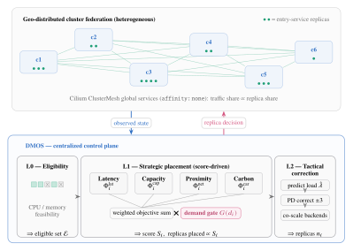
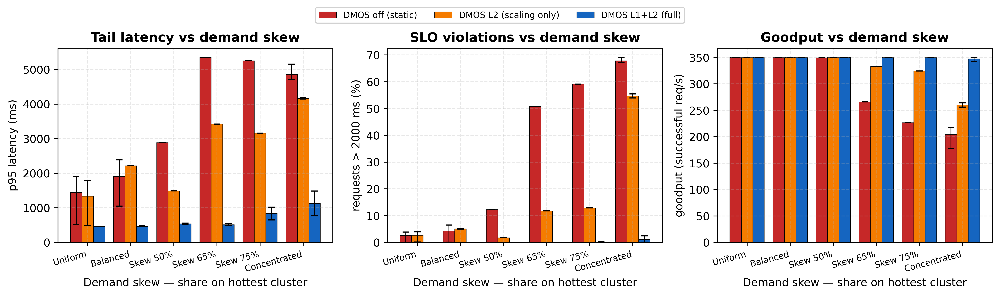
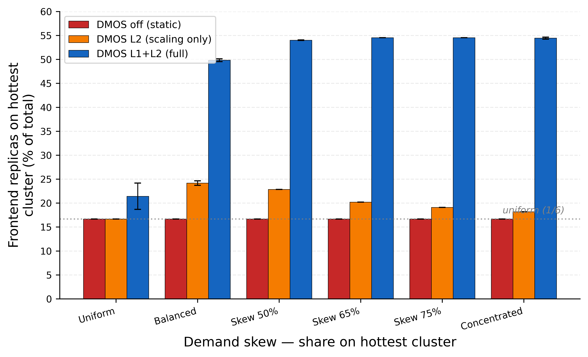

# DMOS: Demand-Gated Multi-Objective Replica Placement for Geo-Distributed Multi-Cluster Systems

| | |
|---|---|
| **Authors** | Angelo Marchese, Matteo Santanocito, Orazio Tomarchio — Dept. of Electrical, Electronic and Computer Engineering (DIEEI), University of Catania |
| **Venue** | IEEE International Symposium on Network Computing and Applications (NCA) 2026 |
| **Status** | camera-ready; DOI and pages to be added after publication |
| **Funding** | University of Catania, *Piano di incentivi per la ricerca di Ateneo* (Pia.ce.ri) 2024/2026, linea di intervento 1 — "QUIET" |
| **Code** | commit `6f11cbd9` (2026-07-06) — suggested tag `nca-2026` |
| **Evaluation runs** | June 2026 (L1L2 cells on 16 June); figures and tables generated on 2026-06-16 18:27 (`paper_artifacts/20260616_182758`, commit `61d39ba2` plus local changes) |
| **L1L2 configuration** | arm `l1l2` of `experiments/run_naming.py` — see [Configuration that produced the results](#configuration-that-produced-the-results) |

DMOS stands for **Demand-gated Multi-Objective Orchestration System**. The
paper PDF is not part of the repository; this page records the figures, the
numbers, the tests that produced them and how to run them again.

## Summary

Geo-distributed Kubernetes federations must decide, for every service, how
many replicas to run on each cluster while weighing heterogeneous objectives:
user-perceived latency, residual capacity, network proximity and the carbon
intensity of each region's energy mix. DMOS is a centralized multi-cluster
scheduler that folds these four objectives into one score and treats
**demand as a precondition rather than as one more weight**: the observed
demand share of a cluster enters only through a multiplicative gate
`G(d) = (ε + (1−ε)·d)^g`, so a cluster that receives no traffic cannot attract
replicas whatever its other qualities, while among the clusters that do the
weights decide. The score drives a strategic feed-forward placement (Level 1),
refined by a predictive estimate of the scale-up timing and a fine-grained PD
correction (Level 2), with dependency-aware co-scaling of the backends.
On a six-cluster heterogeneous testbed under a sudden demand spike, DMOS keeps
SLO violations at 1.1 % in the concentrated regime, against 67.9 % for static
allocation and 54.7 % for uniform scaling with the same replica budget.

## Contributions

1. **Demand-gated, capacity-aware placement.** Demand is a multiplicative
   precondition of the score, not a competing weight; a capacity-sized replica
   budget is distributed in proportion to the gated score with per-cluster caps
   and multi-pass redistribution. A two-step ablation (OFF → L2 → L1L2)
   attributes the gains to *where* replicas are placed, not to *how many*.
2. **Hybrid feed-forward / feedback control.** Level-1 placement plus a
   trend predictor that anticipates the scale-up timing, a PD correction,
   dependency-aware backend co-scaling (sized from the parent, not from
   retry-inflated observed traffic), asymmetric cooldown, churn budgets and a
   deadband.
3. **Placement–traffic coupling on the data plane** through Cilium ClusterMesh
   global services with `affinity: none`, whereby the traffic share served by
   a cluster follows its share of ready replicas.

## Figures

### Fig. 1 — Architecture



Source: TikZ (`paper/fig_dmos_arch_alt.tex`, with the paper sources, not in
the repository); the SVG here is its export. The design is described in
[`../dmos-architecture.md`](../dmos-architecture.md).

### Fig. 2 — Robustness to demand skew



Peak phase (360–600 s), mean and bootstrap 95 % CI over the repetitions of
each cell: p95 latency, share of requests slower than 2 s or failed, goodput.
Generated by `experiments/paper_plot_skew_robustness.py`; the numbers behind
it are in [`2026-nca-dmos/skew_robustness_data.json`](2026-nca-dmos/skew_robustness_data.json)
(table below).

### Fig. 3 — Frontend replicas on the hottest cluster



Share of the frontend replicas (DMOS `target_replicas`) placed on the hot
cluster ms-cluster-01 during the peak, mean ± std over the repetitions. OFF
stays at 1/6 by construction; L2 scales the total but splits it uniformly;
L1L2 follows the demand up to the per-cluster cap (~54 %). Generated by
`experiments/paper_plot_hotshare.py`.

## Tests performed

| | |
|---|---|
| Workload | k6 from a dedicated VM, 5 phases in 900 s (baseline 50 req/s for 180 s, ramp of 120 s, sustained peak 300–600 s, decline, cool-down), peak **350 req/s**, Online Boutique endpoint mix |
| Regimes | share of the demand on the hot cluster (ms-cluster-01, DE) during the peak: `uni` 1/6, `bal` 0.40, `s50` 0.50, `s65` 0.65, `s75` 0.75, `con` 0.85 |
| Configurations | **OFF** (static: one replica per service per cluster, DMOS not running), **L2** (budget N and the whole Level-2 loop, uniform N/K placement: `--no-scheduling`), **L1L2** (full DMOS) |
| Testbed | six K3s clusters on Proxmox, three hardware tiers, Cilium ClusterMesh v1.19, inter-region delay with `tc netem` (0–200 ms one-way), Online Boutique |
| Metrics | peak phase: p95, error rate, goodput, SLO violation (> 2 s or failed) — definitions in [`../METRICS-AND-OUTPUTS.md`](../METRICS-AND-OUTPUTS.md) |

**Repetitions actually in the dataset** (from `paper_artifacts/20260616_182758/manifest.json`,
`scenarios_found`; the paper says the regimes "are repeated three times"):

| | uni | bal | s50 | s65 | s75 | con |
|---|---:|---:|---:|---:|---:|---:|
| OFF | 3 | 3 | 1 | 1 | 1 | 3 |
| L2 | 3 | 2 | 1 | 1 | 1 | 2 |
| L1L2 | 3 | 3 | 3 | 2 | 3 | 4 |

The same analysis also found cells that are not in the paper:
`dmos-latonly__bal` (2 runs), `dmos-netonly__bal` (3), `dmos-carbon__bal` (3)
(single-objective legacy profiles, today `profile-*`) and
`dmos-l1l2nofloor__con` (1).

The run directories of the campaign are no longer available; the figures and
`skew_robustness_data.json` above are what remains of the measured data.

## Results

Peak phase, mean over the repetitions of each cell (from
`skew_robustness_data.json`; UNI, BAL and CON are Tab. IV of the paper):

| Regime | Config. | n | p95 (ms) | SLO > 2 s | Goodput (req/s) |
|---|---|---:|---:|---:|---:|
| UNI 0.167 | OFF | 3 | 1445 | 2.6 % | 350 |
| | L2 | 3 | 1334 | 2.6 % | 350 |
| | L1L2 | 3 | 458 | 0.0 % | 350 |
| BAL 0.40 | OFF | 3 | 1909 | 4.2 % | 350 |
| | L2 | 2 | 2216 | 5.0 % | 350 |
| | L1L2 | 3 | 465 | 0.0 % | 350 |
| 0.50 | OFF | 1 | 2885 | 12.2 % | 349 |
| | L2 | 1 | 1486 | 1.7 % | 350 |
| | L1L2 | 3 | 539 | 0.0 % | 350 |
| 0.65 | OFF | 1 | 5347 | 50.8 % | 266 |
| | L2 | 1 | 3420 | 11.8 % | 333 |
| | L1L2 | 2 | 511 | 0.0 % | 350 |
| 0.75 | OFF | 1 | 5253 | 59.1 % | 227 |
| | L2 | 1 | 3158 | 12.9 % | 324 |
| | L1L2 | 3 | 839 | 0.1 % | 350 |
| CON 0.85 | OFF | 3 | 4858 | 67.9 % | 204 |
| | L2 | 2 | 4163 | 54.7 % | 260 |
| | L1L2 | 4 | 1127 | 1.1 % | 347 |

Error rates at the peak (paper, Tab. IV): 0 % everywhere except CON — OFF
41.7 %, L2 25.7 %, L1L2 0.7 %. The crossover lies between a 0.50 and a 0.65
share: from 0.65 on OFF and L2 lose goodput while L1L2 keeps the offered
350 req/s. The frontend share on the hot cluster grows from ~21 % (UNI) to
~54 % (the per-cluster cap) for L1L2, while OFF and L2 stay near 1/6 (Fig. 3).

## Configuration that produced the results

The runs predate the run-provenance harness, so the configuration has been
read back from the DMOS logs of the campaign (`logs/DMOSMain*.log`, local).
Every DMOS start between 15 June 11:04 and 17 June 2026 printed:

```
Score weights: lat=0.25, cap=0.2, geo_load=0.25, carbon=0.3, demand=0.0 |
DEMAND-GATE ON (eps=0.05, gamma=2.0) | COERENTE: Φ_loc=Φ_net puro, Φ_pre OFF
```

and the peak allocations show no demand floor. In today's names this is the
arm **`l1l2`** (formerly `l1l2coh`):

```
S = G(d; ε = 0.05, g = 2) · (0.25·Φ_lat + 0.20·Φ_cap + 0.25·Φ_net + 0.30·Φ_car)
DMOS_DEMAND_FLOOR=0 DMOS_SCORE_GATE=1 DMOS_SCORE_GATE_GAMMA=2
DMOS_LOCALITY_PURE_NET=1 DMOS_WEIGHTS_COHERENT=0.25,0.20,0.25,0.30
```

Other facts from the logs and the archived runs:

- **Which L1L2 runs.** The 14 DMOS starts of 15 June ran with RTT = 0 ms on
  every cluster (netem missing); the 19 starts of 16 June (07:33–17:54) had
  the emulated delays. The 18 L1L2 runs of the dataset match the 16 June
  starts (one discarded). The OFF and L2 runs are older and do not appear in
  the available logs.
- **ρ = 3.0** in the campaign (Φ_net = 0.472 at RTT = 125 ms), as in
  `config/weights.yaml`.
- **Carbon.** DE, FR and PL were replayed from the 2025 traces; NO, US-VA
  and SG used the built-in hourly profiles ("Trace NO/SG/US-VA: assente →
  fallback 'realistic'"), which depend on the wall-clock time of the run.
- **Online Boutique `loadgenerator`** was running during the runs (the reset
  of the time scaled every Deployment to 1; the archived runs show
  loadgenerator → frontend flows in Hubble on five clusters).
- **Cold start.** As in §IV-E, the first 120 s after DMOS starts are an
  observation window with no scaling operation; the first allocation uses
  the warm score.
- **Data plane.** The runs did not record the ClusterMesh state; the paper
  describes the frontend as a global service with `affinity: none`, which is
  now the repository manifest (`deployments/global-service-frontend.yaml`)
  and is checked before every run.

### Differences between the paper text and the campaign

| Item | Paper | Campaign / code | Note |
|---|---|---|---|
| Weights (lat, cap, net, car) | (0.25, 0.35, 0.30, 0.10), §V-B | (0.25, 0.20, 0.25, 0.30) | the score model `nca` encodes the paper's weights, the arm `l1l2` the campaign's — to decide for the journal |
| ρ (Tab. I) | 2.0 | 3.0 | |
| Repetitions | three per regime | see the table above (1 to 4) | |
| PD correction | output clipped to [−3, +3] (Tab. II) | correction applied on top of the L1 target clamped to ±1 | `pd_correction_clamp` |
| Co-scaling | Eq. 11 | effective ratio with a floor of 0.3 | `backend_colocation_floor` |
| Proportional distribution | Eq. 8 | plus a "geo-boost": one replica moves to the best-scored cluster in a tie | `winner_determination.py` |
| Carbon intensity | replayed traces | traces for DE, FR, PL only | NO now uses its trace (`zone_aliases`); US-VA and SG still need their files |

## Where the paper lives in the code

| Paper | Code |
|---|---|
| §III-A federation, data plane | `deployments/global-service-*.yaml`, Cilium setup in `scripts/setup-dmos-on-clusters.ps1` — see [architecture §4](../dmos-architecture.md#4-data-plane) |
| §III-B observed state (C, M, λ, L, CI, R, λ^in, d) | `src/metrics/prometheus_client.py`, `src/metrics/carbon_client.py`, `src/level1/dmos_scheduler.py` (`_collect_cluster_metrics`, `collect_scores`) |
| Eq. 1–2 score and gate | `src/level1/score_functions.py` (legacy switches of the arm `l1l2`; score model `nca` in `src/level1/score_model.py`, `config/weights.yaml → score_models`) |
| Eq. 3–6 objective components | `ScoreFunctions.compute_latency_score / compute_capacity_score / compute_carbon_score / compute_network_score` |
| Tab. I parameters | `ScoreParameters` (`score_functions.py`) + `config/weights.yaml → network_parameters` |
| §IV-A L0 eligibility | `dmos_scheduler.py` (`CPU_HARD_LIMIT_PCT`, `MEMORY_HARD_LIMIT_PCT`, `MIN_*_AVAILABLE`) |
| Eq. 7 budget N | `dmos_main.py → schedule_service` (sum of per-cluster `ceil(λ_i / c_i)`) |
| Eq. 8 proportional, capacity-aware distribution | `src/level1/winner_determination.py → allocate` |
| Eq. 9 predictor, timing anticipation | `src/level2/predictor.py`, `dmos_main.py → periodic_check_thread` |
| Eq. 10 PD correction | `src/level2/pd_controller.py`, `dmos_main.py → schedule_service` (Step 2b) |
| Eq. 11 backend co-scaling | `dmos_main.py → _enforce_colocation` |
| §IV-E safeguards, two-phase start-up, Tab. II | `dmos_main.py` (`DMOSOrchestrator.__init__`), `dmos_scheduler.py` (`COLD_START_SECONDS`) — [two-phase-scheduling.md](../two-phase-scheduling.md) |
| §V-A testbed, Tab. III | `config/local.yaml` (gitignored; template `config/local.yaml.example`), `config/services.yaml`, `data/carbon_traces/` |
| §V-B workload and configurations | `experiments/k6_flash_crowd.js`, `experiments/run_naming.py` (arms and regimes), `experiments/run_matrix_session.sh`, `experiments/run_one.sh` |
| Fig. 1 architecture | [`2026-nca-dmos/fig_dmos_arch.svg`](2026-nca-dmos/fig_dmos_arch.svg) (TikZ source with the paper sources) |
| Fig. 2 robustness to demand skew (p95 / SLO / goodput) | `experiments/paper_plot_skew_robustness.py` → `fig_skew_robustness.{pdf,png}` + `skew_robustness_data.json` |
| Fig. 3 frontend replica share on the hottest cluster | `experiments/paper_plot_hotshare.py` → `figpaper_hotshare_skew.{pdf,png}` |
| Tab. IV peak metrics (UNI / BAL / CON) | per-run `flash_crowd_summary.json` + SLO cache (`paper_slo_compliance.py`), aggregated by `paper_stat_compare.py` and `paper_plot_skew_robustness.py` |

## Running the evaluation again

Test names are `dmos-<arm>__<regime>` (`experiments/run_naming.py`); the
three configurations of the paper are the arms `off`, `l2`, `l1l2`. One
repetition of the 18 cells (the three arms of a regime run consecutively):

```bash
export DMOS_K6_REMOTE=ubuntu@<K6_VM_IP>
bash experiments/preflight_runs.sh
bash experiments/run_matrix_session.sh                        # off l2 l1l2 × uni bal s50 s65 s75 con
bash experiments/run_matrix_session.sh --arms "off l2 nca"    # the same with the weights stated in the paper
bash experiments/run_one.sh l1l2 con                          # a single cell
```

Run it once per session, as many sessions as repetitions. Every new run
records its effective configuration, the testbed state and provenance
checks ([`../RUN-PROVENANCE.md`](../RUN-PROVENANCE.md)); the figures:

```bash
python experiments/paper_generate_all.py
python experiments/paper_plot_hotshare.py
```

## How to cite

```bibtex
@inproceedings{marchese2026dmos,
  author    = {Marchese, Angelo and Santanocito, Matteo and Tomarchio, Orazio},
  title     = {{DMOS}: Demand-Gated Multi-Objective Replica Placement for
               Geo-Distributed Multi-Cluster Systems},
  booktitle = {Proceedings of the IEEE International Symposium on Network
               Computing and Applications (NCA)},
  year      = {2026},
  note      = {to appear}
}
```
